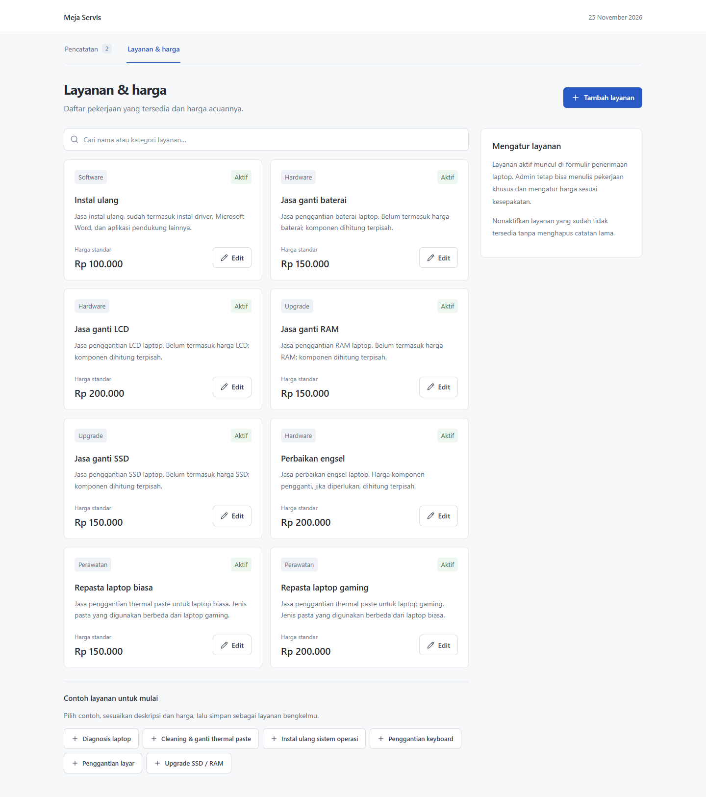

# Meja Servis

Meja Servis membantu bengkel laptop mencatat perangkat pelanggan sejak diterima hingga diambil kembali. Dalam satu catatan, admin bisa melihat keluhan pelanggan, hasil pemeriksaan, pekerjaan yang disepakati, dan sisa pembayaran.

- **Penerimaan laptop** — catat nama dan kontak pelanggan, model perangkat, nomor seri, tanggal masuk, serta kelengkapannya.
- **Pengerjaan** — tulis diagnosis, pilih layanan dari katalog, tambahkan suku cadang, dan perbarui status.
- **Pembayaran** — hitung total dari jumlah dan harga satuan, catat uang muka, lalu lihat sisa tagihan. Perubahan harga katalog berlaku untuk pekerjaan baru.

Pada laptop Windows yang sudah disiapkan, klik dua kali **Buka MejaServis.cmd**. Data pelanggan dan katalog lokal disimpan di komputer bengkel. Lihat [panduan penggunaan dan pencadangan](PANDUAN-LOKAL.md).
